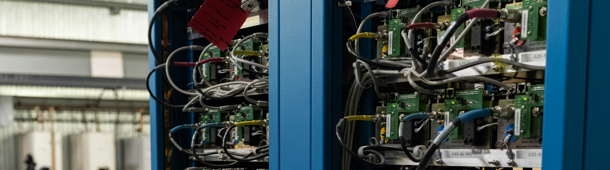

  

<h1 align="center">Alexandru Picioroagă</h1>

<strong>DevOps Engineer @ Endava</strong> · Iași, Romania

Computer Science graduate from Alexandru Ioan Cuza University of Iași, now pursuing a master’s degree in Advanced Studies in Computer Science at UAIC.

## Projects

- **DevOps** — [Disease Prediction](https://github.com/orgs/Disease-Prediction-ASET26/repositories): [CI/CD](https://github.com/Disease-Prediction-ASET26/disease-prediction-ci) · [GitOps](https://github.com/Disease-Prediction-ASET26/disease-prediction-gitops) · [Infrastructure as Code](https://github.com/Disease-Prediction-ASET26/disease-prediction-infra) · [Quizzy](https://github.com/picalexs/Quizzy).
- **Quantum computing** — [Iota](https://github.com/picalexs/Iota) (molecular simulation) · [R2P Capstone](https://github.com/picalexs/R2P_Capstone) (2nd place) · [Qiskit Global Summer School 2025](https://github.com/picalexs/QGSS-2025).
- **Game development** — [LightBender](https://github.com/picalexs/LightBender) (Godot) · [Swap the World](https://github.com/picalexs/Swap-The-World) (Unity) · [Fearfront](https://github.com/picalexs/Fearfront) (VR) · [World Biome Generation](https://github.com/picalexs/World-Biome-Generation) · [Mixed Realities coursework](https://github.com/picalexs/mixed-realities-FII).

**Tools:** AWS · Docker · GitHub Actions · Terraform · Kubernetes · Python · C# · Unity · Godot 
**Highlights:** AWS Certified Cloud Practitioner · Qiskit Global Summer School 2026 Quantum Excellence · BSc thesis graded 10/10

## Connect

[LinkedIn](https://www.linkedin.com/in/picalexs/) · [Credly badges](https://www.credly.com/users/alexandru-daniel-picioroag)

Banner photo by [Eric Stoynov](https://unsplash.com/photos/two-server-racks-filled-with-electronic-components-and-wires-k27hkqXuveo) on Unsplash · [License](https://unsplash.com/license)
